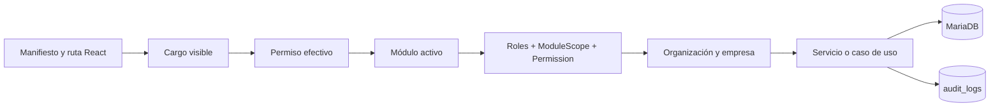

# Arquitectura y accesos

[Volver al resumen](gobierno-modulos-legales.md) · [Índice de documentación](../README.md)

## Explicación simple

Ver una opción en el menú no basta para poder usarla. El sistema comprueba el cargo, el permiso, si el módulo está activo y qué empresa se está administrando. La API repite la validación aunque alguien intente saltarse la pantalla.

## Recorrido técnico de una solicitud

## Responsabilidades

### Dirección Comercial

- Cambia configuración global.
- Activa o desactiva módulos opcionales.
- Modifica la matriz de permisos.
- Administra cargos internos, incluido Desarrollo.
- Reenvía accesos y revisa excepciones.

### Desarrollo

- Conserva acceso de recuperación y soporte técnico.
- Puede realizar las mismas acciones globales sensibles.
- No reemplaza la decisión comercial sobre qué módulos usar.

### Dirección de Operaciones

- Administra trabajo operativo y usuarios no privilegiados.
- Puede revisar permisos necesarios para su equipo.
- No controla la matriz global ni asigna Desarrollo.

### Administrador de empresa

- Sigue siendo `client`.
- Recibe `users:manage` para una empresa concreta.
- No obtiene configuración global, integraciones globales ni gobierno de otras empresas.

### Admin legado

- No se puede crear nuevamente.
- No accede a la configuración general.
- Puede seguir mencionado temporalmente en rutas heredadas mientras se retira compatibilidad.

## Capas de implementación

| Capa | Responsabilidad | Fuente principal |
|---|---|---|
| Navegación | Mostrar rutas permitidas | `apps/web/src/**/feature.manifest.ts` |
| Interfaz | Ocultar o deshabilitar acciones | `AdminPage`, `SettingsPage`, `EquipoYAccesos` |
| Permiso base | Nivel inicial por cargo | `role-permissions.ts` |
| Excepciones | Ajustes por usuario o cargo | `permissions.controller.ts` |
| Módulo | Encendido por organización | `organizations.controller.ts` |
| API | Rechazo autoritativo | decoradores y guardas NestJS |
| Empresa | Aislamiento multiempresa | servicios de alcance de cuenta |
| Evidencia | Registro de acciones | `audit_logs` |

## Invariantes

1. Ninguna acción global depende solo del frontend.
2. Cambiar módulos o permisos sensibles requiere autenticación reciente.
3. Una excepción individual no debe ampliar el alcance de empresa.
4. Cambiar permisos invalida cachés de usuario y organización.
5. Toda ruta visible debe tener módulo y permiso efectivos coherentes.

