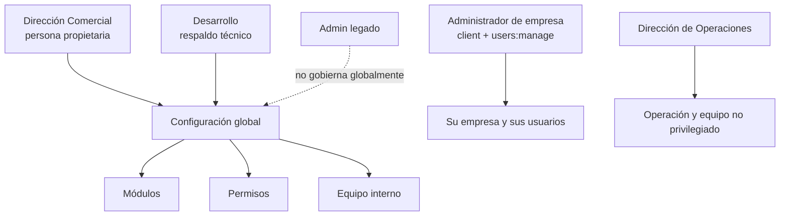

# Gobierno de módulos, accesos y documentos legales

Estado documentado: 16 de noviembre de 2026.

Este documento es el punto de entrada. Explica la decisión sin exigir conocimientos técnicos y enlaza el detalle verificable.

## En una frase

Dirección Comercial es la persona propietaria de la agencia; Desarrollo es su respaldo técnico; cada administrador de empresa solo administra su propia empresa; el antiguo cargo `admin` deja de gobernar globalmente.

## Qué controla cada nivel

## Lecturas según necesidad

- [Arquitectura y accesos](arquitectura-y-accesos.md): cómo se conectan menú, permisos, módulos, API y empresa.
- [Legales, reservas y comunicaciones](legal-reservas-comunicaciones.md): versiones, aceptaciones, configuración por empresa y correos a no registrados.
- [Validación, riesgos y operación](validacion-riesgos-operacion.md): qué está comprobado, qué falta y cómo cambiar sin romper.

## Respuesta rápida

- Activar Reservas no publica automáticamente textos legales de una empresa.
- La configuración legal de empresa es independiente y solo se usa si se habilita.
- Un documento publicado no se edita: se crea una versión nueva.
- Cada aceptación conserva la versión exacta aceptada.
- Los permisos visibles en pantalla también se vuelven a comprobar en la API.
- Dar `users:manage` a un cliente no lo convierte en dueño global.

## Fuentes principales del código

- Permisos base: `apps/api/src/core/authorization/role-permissions.ts`.
- Matriz: `apps/api/src/core/authorization/permissions.controller.ts`.
- Configuración: `apps/api/src/core/parameters/organization-settings.controller.ts`.
- Módulos: `apps/api/src/modules/organizations/organizations.controller.ts`.
- Usuarios: `apps/api/src/modules/users/`.
- Pantalla de gobierno: `apps/web/src/features/admin/AdminPage.tsx`.
- Pantalla de configuración: `apps/web/src/features/settings/SettingsPage.tsx`.
- Equipo y accesos: `apps/web/src/features/users/EquipoYAccesos.tsx`.

