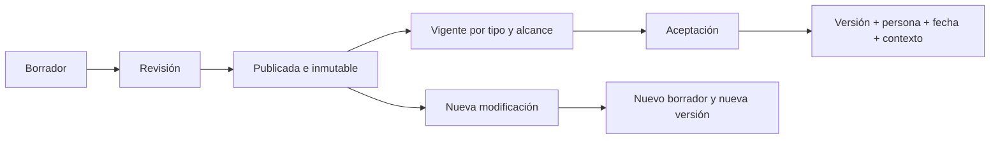
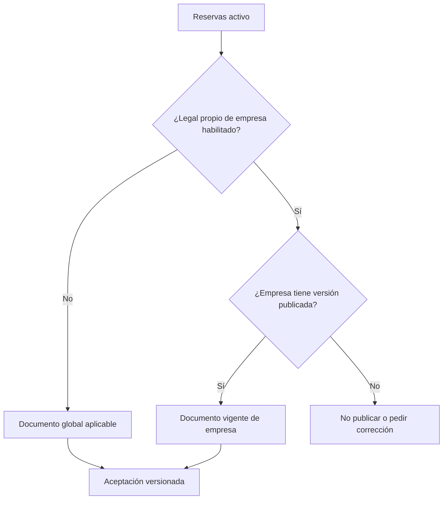

# Legales, reservas y comunicaciones

[Volver al resumen](gobierno-modulos-legales.md) · [Índice de documentación](../README.md)

## Separación conceptual

Hay dos niveles distintos:

- Gobierno legal global: privacidad, términos y consentimientos de la plataforma.
- Legal de empresa: información y textos propios de una empresa cliente.

Reservas consume estas reglas, pero no debe ser el dueño de los documentos legales.

## Ciclo de una versión legal

Una modificación no sobrescribe el pasado. Crea una nueva versión del mismo tipo de documento y alcance.

## Activación desde Reservas

- Activar Reservas no activa por sí solo el legal de empresa.
- Dirección Comercial habilita o deshabilita esa capacidad.
- Si se habilita, debe existir una versión válida antes de exponerla públicamente.
- Deshabilitarla no borra versiones ni aceptaciones anteriores.

## Correos a personas no registradas

Antes de enviar deben quedar registrados:

- procedencia de los destinatarios;
- fundamento del contacto;
- empresa y flujo que originaron el envío;
- versión o contenido utilizado;
- destinatario, fecha, resultado y motivo de omisión;
- bajas y exclusiones aplicadas.

Una baja o exclusión prevalece sobre una importación posterior. Un correo transaccional y uno promocional no comparten automáticamente el mismo fundamento.

## Datos relacionados

- `legal_document_versions`: versiones legales de cada empresa.
- `legal_acceptance_events`: aceptaciones de documentos de empresa.
- `legal_activation_events`: activación o desactivación del módulo legal por empresa.
- `consent_versions`: versiones de consentimientos globales de la plataforma.
- `data_consents`: aceptaciones globales asociadas a una cuenta.
- `clients`: identidad y configuración de empresa.
- `audit_logs`: quién modificó o publicó.
- registros de correo y supresión: envío, resultado y exclusión.

## Regla de edición

| Estado | Se puede editar | Resultado |
|---|---:|---|
| Borrador | Sí | Se actualiza el borrador |
| Publicado | No | Se crea una versión nueva |
| Reemplazado | No | Se conserva como evidencia |
| Deshabilitado | No se borra | Deja de seleccionarse para usos nuevos |

