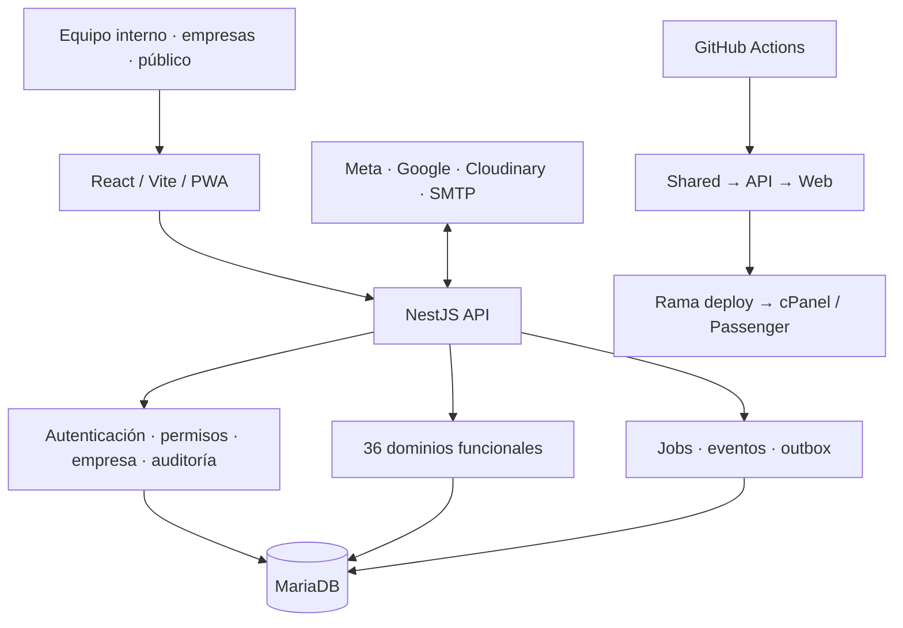

# Mapa maestro del sistema

Estado del inventario: 16 de noviembre de 2026.

Este índice cubre el repositorio completo. Está pensado para dos tipos de lectura:

- Lectura general: qué resuelve cada área y cómo se relaciona con las demás.
- Lectura técnica: frontend, API, datos, procesos asíncronos, integraciones, seguridad, pruebas y despliegue.

## Documentos

1. [Mapa funcional de todos los módulos](mapa-funcional.md)
2. [Arquitectura técnica de extremo a extremo](arquitectura-tecnica.md)
3. [Datos, integraciones y procesos automáticos](datos-integraciones-automatizacion.md)
4. [Calidad, seguridad, operación y despliegue](calidad-seguridad-operacion.md)
5. [Gobierno, permisos y legales](../forense/gobierno-modulos-legales.md)

## Dimensión actual

| Área inventariada | Cantidad |
|---|---:|
| Dominios backend en `apps/api/src/modules` | 36 |
| Áreas frontend en `apps/web/src/features` | 37 |
| Componentes transversales backend en `apps/api/src/core` | 19 |
| Migraciones de base de datos | 180 |
| Jobs programados | 17 |
| Archivos de pruebas unitarias API | 261 |
| Archivos E2E API | 16 |
| Archivos de pruebas web | 70 |

Las cantidades sirven para detectar cambios de alcance. El código es la fuente autoritativa si este inventario queda desactualizado.

## Vista general

