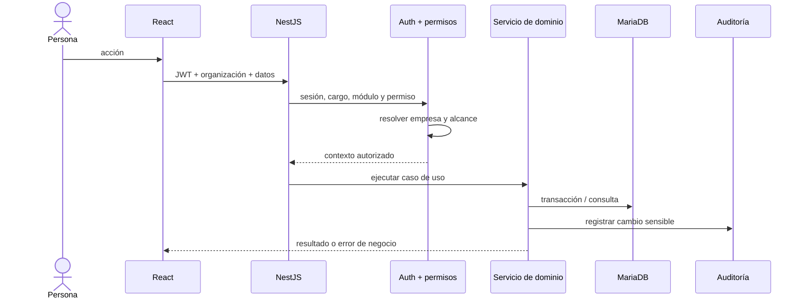

# Arquitectura técnica de extremo a extremo

[Volver al mapa maestro](README.md)

## Repositorio

| Componente | Tecnología | Responsabilidad |
|---|---|---|
| `apps/web` | React 19, Vite 8, PWA | Navegación, pantallas y experiencia pública/privada |
| `apps/api` | NestJS 11, TypeORM | API, reglas de negocio, seguridad y persistencia |
| `packages/shared` | TypeScript | Contratos, tipos y reglas compartidas |
| `scripts` | Node, shell y CMD | Build, despliegue, diagnóstico, calidad y smoke tests |
| `.github/workflows` | GitHub Actions | Calidad, pruebas y rama de despliegue |

## Recorrido de una solicitud privada

## Núcleo transversal

| Área core | Función |
|---|---|
| `auth` | Inicio, renovación, sesiones, onboarding y recuperación |
| `authorization` | Roles, matriz, permisos, acciones y guardas |
| `organization` | Contexto y aislamiento por organización |
| `client-scope` | Alcance por empresa y capacidades contratadas |
| `audit` | Bitácora de cambios sensibles |
| `data-protection` | Versiones y aceptaciones globales |
| `parameters` | Configuración y plantillas por alcance |
| `notifications` | Correo, notificaciones, destinatarios y registro |
| `events` | Reacciones desacopladas a eventos de dominio |
| `jobs` / `cron` | Ejecución programada y trazabilidad |
| `outbox` | Entrega confiable hacia servicios externos |
| `health` / `observability` | Salud, métricas y registro de errores |
| `errors` | Errores de negocio, validación y respuestas uniformes |
| `process-history` | Historia de etapas y aperturas |
| `cloudinary` | Gestión central de imágenes |

## Modelo de protección

Una operación puede atravesar estas puertas:

1. Ruta pública explícita o JWT válido.
2. Organización resuelta.
3. Cargo permitido por `@Roles`.
4. Módulo declarado con `@ModuleScope`.
5. Feature activa para la organización.
6. Nivel de permiso suficiente.
7. Empresa accesible y capacidad contratada.
8. Reautenticación reciente para acciones sensibles.
9. Validación del DTO y reglas del caso de uso.
10. Auditoría y transacción cuando corresponde.

## Superficies públicas

Existen rutas públicas controladas para autenticación, salud, reservas, encuestas, invitaciones, captación de leads, bajas de correo, solicitudes de derechos, webhooks y tareas cron autenticadas por su propio mecanismo. `@Public()` elimina el JWT general, no la obligación de validar token, firma, secreto, límites o alcance dentro del flujo.

## Frontend

- Los `feature.manifest.ts` describen navegación y roles visibles.
- El router separa rutas públicas, internas y portal de cliente.
- React Query administra caché y sincronización con la API.
- Los permisos de interfaz mejoran la experiencia, pero la API es la autoridad.
- Los formularios públicos reutilizan contratos compartidos y validaciones del servidor.

