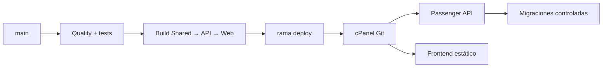

# Calidad, seguridad, operación y despliegue

[Volver al mapa maestro](README.md)

## Pirámide de verificación

| Nivel | Cobertura |
|---|---|
| Lint y TypeScript | Contratos, imports, hooks y errores estáticos |
| Unitarias API | Servicios, casos de uso, permisos y contratos |
| Pruebas web | Navegación, reglas compartidas y componentes |
| E2E API | Guardas, base de datos, estados imposibles y aislamiento |
| Build cPanel | Shared, API, Web y artefactos productivos |
| Smoke / diagnóstico | Integración real, concurrencia y servidor desplegado |

Inventario actual: 261 archivos unitarios API, 16 E2E y 70 pruebas web.

## Flujo de entrega

## Controles de seguridad

- JWT, sesiones revocables y cambio de contraseña.
- Reautenticación reciente en operaciones críticas.
- Matriz de permisos más excepciones auditadas.
- Aislamiento por organización y empresa.
- Rate limiting por proceso y límites específicos de recursos.
- Sanitización de auditoría y errores.
- Rutas públicas explícitas y revisables.
- Supresión de correos, solicitudes de derechos e incidentes.
- Validación de URLs, archivos y entradas externas.

## Límites conocidos

- El rate limit vive en memoria de cada proceso; la capacidad efectiva depende de la cantidad de procesos Passenger.
- E2E y pruebas HTTP requieren MariaDB y permisos de red local.
- `admin` sigue presente en compatibilidad heredada y debe retirarse módulo por módulo.
- El tamaño del bundle principal merece seguimiento aunque no impide el build.
- Una advertencia de CI no equivale a fallo, pero acumularlas oculta regresiones nuevas.

## Operación

- [Checklist de despliegue](../deployment/DEPLOY-CHECKLIST-IHOSTING.md)
- [Configuración iHosting](../deployment/ihosting.md)
- [Historial de despliegue](../deployment/HISTORIAL-DESPLIEGUE.md)
- [Tareas programadas](../operacion/TAREAS-PROGRAMADAS.md)
- [Diagnóstico y limpieza](../operacion/DIAGNOSTICO_Y_LIMPIEZA.md)
- [Política de inodos](../deployment/POLITICA-INODOS.md)

## Criterio global de terminado

Una función está terminada cuando frontend, API, datos, permisos, alcance de empresa, auditoría, pruebas, documentación y despliegue coinciden. Compilar una capa aislada o mostrar una pantalla no prueba el recorrido completo.

