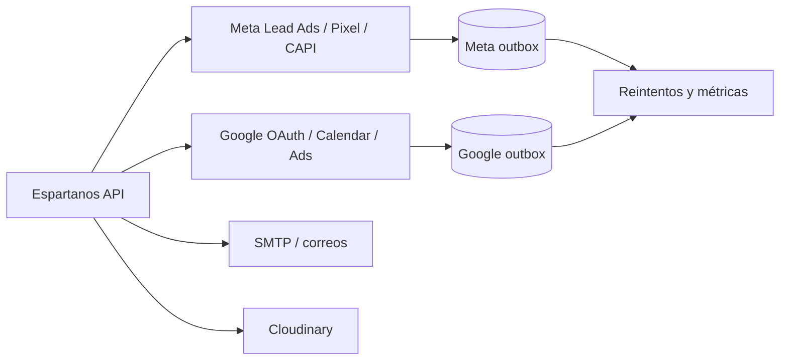
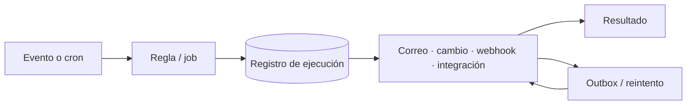

# Datos, integraciones y procesos automáticos

[Volver al mapa maestro](README.md)

## Persistencia

MariaDB es la fuente transaccional. TypeORM registra entidades y las migraciones modifican el esquema; `synchronize` permanece desactivado. Hay 180 migraciones en el inventario actual.

## Familias de datos

| Familia | Ejemplos de tablas |
|---|---|
| Identidad y acceso | `users`, `user_sessions`, `user_permission_overrides`, `user_client_access`, `perfiles` |
| Empresas y gobierno | `organizations`, `clients`, `audit_logs`, `parameter_values` |
| CRM | `leads`, `crm_contacts`, `crm_opportunities`, `crm_interactions`, `crm_campaigns` |
| Producción | `pieces`, `piece_versions`, `corrections`, `content_grids`, `content_items` |
| Reservas | `reservation_forms`, `reservations`, `reservation_events`, `reservation_holds`, `reservation_coupons` |
| Encuestas | `surveys`, `survey_responses`, `survey_contact_requests` |
| Marketing | `email_subscribers`, `email_campaigns`, `email_campaign_sends`, `email_suppression` |
| Legal y privacidad | `consent_versions`, `data_consents`, `legal_document_versions`, `legal_acceptance_events`, `service_requests` |
| Integraciones | `integrations`, `integration_accounts`, `meta_pixels`, outboxes de Meta y Google |
| Automatización | `automations`, `automation_runs`, `automation_run_steps`, `automation_webhook_deliveries` |
| Finanzas y desempeño | `invoices`, `charge_notes`, `ud_budgets`, `ud_movements`, `xp_events`, `monthly_reports` |

## Integraciones

- Meta: OAuth, activos, leads, píxeles por empresa, CAPI y recuperación de webhooks.
- Google: cuentas, calendario, OAuth y conversiones con outbox.
- SMTP: correos transaccionales y campañas, bajas, exclusiones y registro de entrega.
- Cloudinary: imágenes globales y de formularios.

## Automatizaciones y jobs

El motor de automatizaciones guarda definición, ejecución, pasos y entregas webhook. Los 17 jobs programados cubren reservas, encuestas, cupones, recordatorios, ciclos, retención, leads detenidos, recuperación de integraciones, cumpleaños, resúmenes y alertas.

## Reglas operativas

- Los cambios multi-tabla sensibles deben usar transacción.
- Los eventos externos deben ser idempotentes.
- Tokens y secretos no se escriben completos en logs ni auditoría.
- Los outboxes separan la transacción local de la entrega externa.
- Los jobs registran ejecución para distinguir “no corrió” de “corrió sin resultados”.
- La retención y anonimización no deben borrar evidencia legal que todavía deba conservarse.

