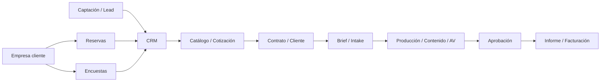

# Mapa funcional de todos los módulos

[Volver al mapa maestro](README.md)

## Para cualquier persona

Espartanos reúne el ciclo comercial, la operación de la agencia y los servicios que usan las empresas clientes. No todos los módulos aparecen para todos: cargo, permiso, empresa contratada y estado de activación determinan qué se ve.

## Dirección y administración

| Módulo | Qué resuelve | Área principal |
|---|---|---|
| `organizations` | Organización raíz, módulos y configuración de plataforma | API |
| `users` | Cuentas, perfiles, invitaciones y accesos | API + Web |
| `clients` | Empresas, capacidades contratadas y datos legales | API + Web |
| `client-portal` | Inicio y experiencia de una empresa cliente | API + Web |
| `onboarding` | Puesta en marcha de nuevas empresas | API + Web |
| `direction` | Vista de dirección y decisiones globales | Web |
| `objectives` | Objetivos de gestión | API |
| `pods` | Equipos o pods y sus integrantes | API |
| `account-cycles` | Ciclos operativos o comerciales de cuenta | API |
| `settings` / `admin` | Configuración, módulos, matriz y seguridad | Core + Web |

## Comercial y relación con clientes

| Módulo | Qué resuelve | Dependencias importantes |
|---|---|---|
| `crm` | Leads, contactos, oportunidades, actividad, campos y reglas | Integraciones, usuarios, clientes |
| `catalog` | Servicios, packs y cotizaciones | Clientes, contratos, CRM |
| `contracts` | Contratos y servicios contratados | Catálogo, clientes |
| `marketing` | Suscriptores, campañas, bajas y exclusiones | Correo, clientes, legal |
| `surveys` | Encuestas, respuestas, distribución y resultados | Clientes, legal, correo |
| `reservations` | Formularios, disponibilidad, reservas, grupos y cupones | Clientes, legal, correo, integraciones |
| `meetings` | Reuniones y acciones posteriores | Clientes, usuarios |
| `briefs` | Encargos entregados por clientes | Clientes, producción |
| `intake` | Solicitudes de trabajo estructuradas | Clientes, procesos |

## Producción y entrega

| Módulo | Qué resuelve | Dependencias importantes |
|---|---|---|
| `production` | Piezas, versiones, estados, correcciones y tipos | Usuarios, clientes, comentarios |
| `content` | Grillas e ítems de contenido | Clientes, producción |
| `audiovisual` | Sesiones y moodboards audiovisuales | Clientes, comentarios |
| `approvals` | Solicitudes de aprobación y tareas | Producción, clientes |
| `collaboration` | Comentarios transversales de procesos | CRM, producción, audiovisual, intake |
| `documents` | Archivos y documentos operativos | Clientes, uploads |
| `uploads` | Registro y entrega de archivos cargados | Cloudinary / almacenamiento |
| `process-templates` | Plantillas de flujo de trabajo | Producción e intake |
| `saved-views` | Vistas y filtros guardados | Módulos con listados |

## Finanzas, desempeño y conocimiento

| Módulo | Qué resuelve | Dependencias importantes |
|---|---|---|
| `billing` | Facturas y notas de cobro | Clientes, contratos |
| `design-budget` | Presupuesto UD, reservas y consumos | Producción, clientes |
| `gamification` | XP, períodos y disputas | Usuarios, producción |
| `reports` | Informes mensuales y métricas | CRM, producción, clientes |
| `knowledge` | Fragmentos y base de conocimiento | Operación e IA |

## Automatización, integraciones y control

| Módulo | Qué resuelve | Dependencias importantes |
|---|---|---|
| `automations` | Disparadores, acciones, ejecuciones y webhooks | Eventos, jobs, dominios |
| `integrations` | Cuentas externas, métricas y conexiones | Meta, Google |
| `operations` | Estado técnico y operación del sistema | Salud, jobs, integraciones |
| `service-requests` | Solicitudes de derechos y seguimiento | Privacidad, auditoría |
| `vulneraciones` | Incidentes de seguridad y privacidad | Auditoría, notificaciones |

## Áreas frontend adicionales

`dashboard`, `auth`, `notifications`, `reports`, `security`, `legal`, `registro-de-correos`, `governance`, `pulse` y `not-found` completan navegación, acceso, documentos públicos, seguridad, observabilidad visual y estados de interfaz. Algunas no tienen un módulo backend con el mismo nombre porque consumen servicios transversales o varios dominios.

## Flujo de valor principal

